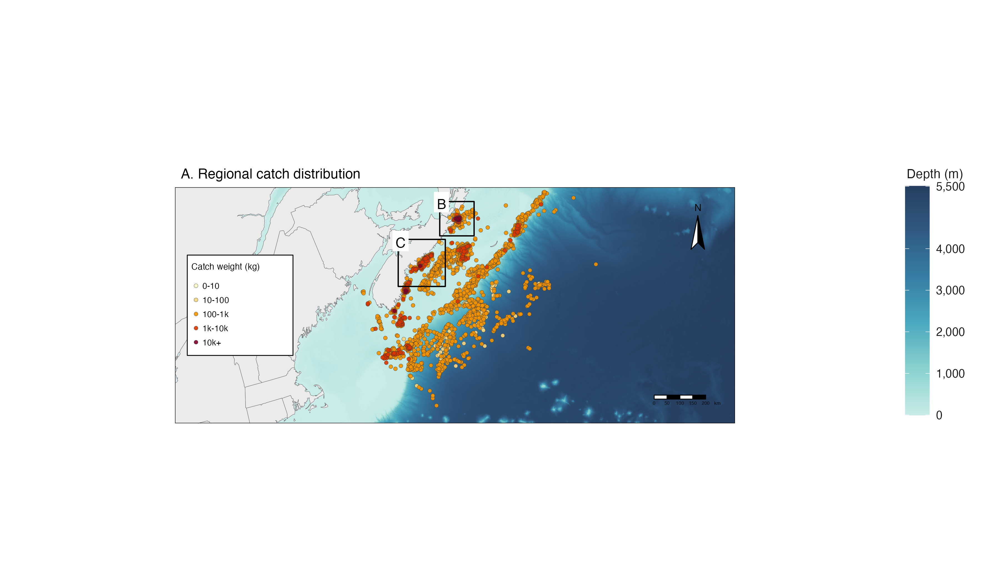
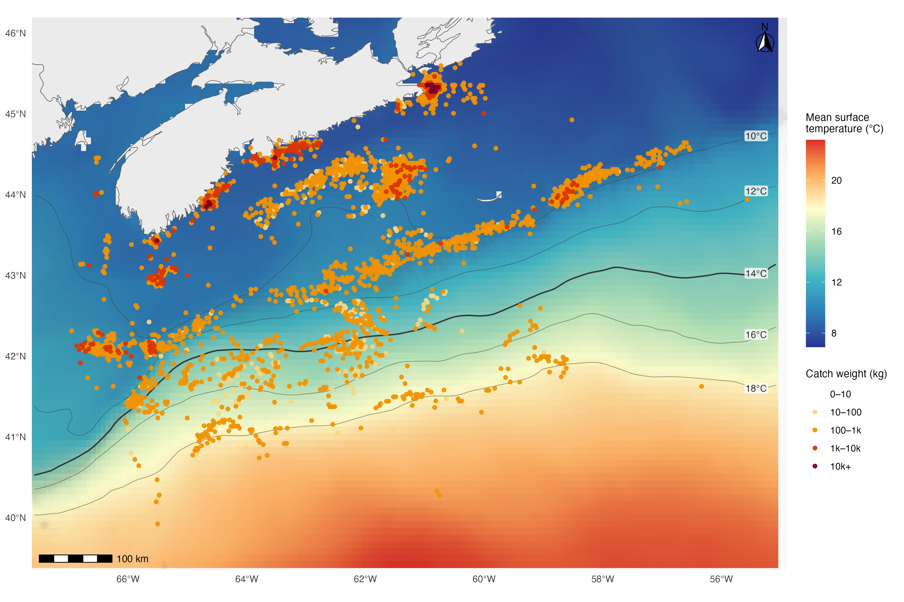

# Atlantic Bluefin Tuna: Spatial Patterns in Reported Catch
In this project, I explore the spatial distribution of reported Atlantic bluefin 
tuna catches in Atlantic Canada and their associations with seabed depth and 
ocean temperature. The study focuses on the Scotian Shelf and adjacent Atlantic 
waters, using commercial fisheries records aggregated across 2019–2023.

## Research Question
How are reported Atlantic bluefin tuna catches distributed across the study area, 
and how do those patterns correspond with bathymetry and the temperature field 
used in this analysis?

Note: the fisheries records represent reported commercial landings, not tuna 
abundance. Fishing effort is not available, and a reporting cell without a 
reported catch should not be interpreted as having zero catch.

## Data sources

The source datasets are retained under [`data/raw_data/`](data/raw_data/).

- **Fisheries and Oceans Canada (DFO), Maritimes Fisheries Atlas (2019–2023):** Reported commercial bluefin tuna landings aggregated into spatial reporting cells. The geodatabase, atlas documentation, and data dictionaries are in [`data/raw_data/DFO_FisheriesAtlas/`](data/raw_data/DFO_FisheriesAtlas/).
- **GEBCO 2026:** Bathymetric data used to derive seabed depth and the 200 m contour. The regional GeoTIFF is in [`data/raw_data/GEBCO/`](data/raw_data/GEBCO/); the folder also contains GEBCO documentation and terms of use.
- **Copernicus Marine GLORYS12V1:** Monthly NetCDF data for 2019–2023. The workflow uses the `thetao` temperature variable to produce a five-year mean temperature raster. The source file is in [`data/raw_data/Copernicus/`](data/raw_data/Copernicus/).

The environmental data cover around 68°W-55°W and 39°N-48°N. The exact product download links and access dates are not recorded in the project files; consult the included source documentation when citing or reusing the datasets.

## Repository structure

- `01_DataSetValidation.Rmd` — inspects the source datasets and their spatial and temporal properties.
- `01_DatasetValidation.html` — rendered validation report.
- `02_DFOFisheriesAtlas.R`–`08_Figure2_SpatialOceanography.R` — numbered R scripts for data preparation, processing, integration, analysis, and figure production.
- `data/raw_data/` — original source datasets and supporting documentation.
- `data/processed_data/` — derived bathymetry, temperature, and integrated fisheries-environment data.
- `outputs/` — summary statistics and correlation tables.
- `figures/` — final figure files.


## Worklow and methods

Spatial processing and analysis were conducted in R using `sf`, `terra`,
`dplyr`, `tmap`, `ggplot2` and `dbscan`.

The numbered scripts follow this workflow:

1. Validate the fisheries, bathymetry, and oceanographic source data.
2. Prepare and inspect the DFO bluefin tuna catch data.
3. Derive seabed depth and the 200 m bathymetric contour from GEBCO.
4. Calculate a 2019-2023 mean from the Copernicus Marine temperature data.
5. Extract environmental values for the fisheries reporting cells and calculate distance to the 200 m contour.
6. Summarize reported catch and environmental variables, including Spearman rank correlations.
7. Map regional catch patterns and high-catch clusters.
8. Map catch patterns alongside the five-year mean temperature field.

High-catch cells were defined using the 90th percentile of reported catch
weight. DBSCAN clustering used a 30 km neighbourhood and a minimum of four
cells per cluster. The two clusters with the highest total reported catch
were selected for detailed mapping.

## Results

The analysis identified pronounced spatial variation in reported commercial catch:

- Approximately 1.40 million kg of reported catch was distributed across
  2,163 reporting cells.
- The highest-catch 10% of cells accounted for approximately 61% of total
  reported catch weight.
- Reported catch weight showed negative rank associations with mean seabed
  depth and five-year mean surface temperature.
- The two largest high-catch spatial clusters were examined in detail
  against local bathymetry.

## Final Figures

**Figure 1A. Reported catch distribution and bathymetry**  


**Figures 1B–C. High-catch clusters and bathymetry**  
The two highest-catch clusters were selected from top-decile reporting cells using DBSCAN.  


**Figure 2. Catch distribution and temperature**  
Reported catches over the 2019–2023 mean temperature field, with labelled isotherms and bathymetric shading.  


## Reproducibility

Open `AtlanticBluefinTuna.Rproj` in RStudio so project-relative paths resolve from the repository root. Render the validation report, then run the numbered scripts in order in the same R session:

```r
rmarkdown::render("01_DataSetValidation.Rmd")
source("02_DFOFisheriesAtlas.R")
source("03_Bathymetry.R")
source("04_Copernicus_OceanographicAnalysis.R")
source("05_FisheriesEnvironmentalSpatialIntegration.R")
source("06_BluefinTuna_EnvirAssociations.R")
source("07_Figure1_SpatialVisualisations.R")
source("08_Figure2_SpatialOceanography.R")
```

Scripts 03–08 write derived data, tables, and figures to `data/processed_data/`, `outputs/`, and `figures/`. The source datasets must be present in their documented locations under `data/raw_data/`.
